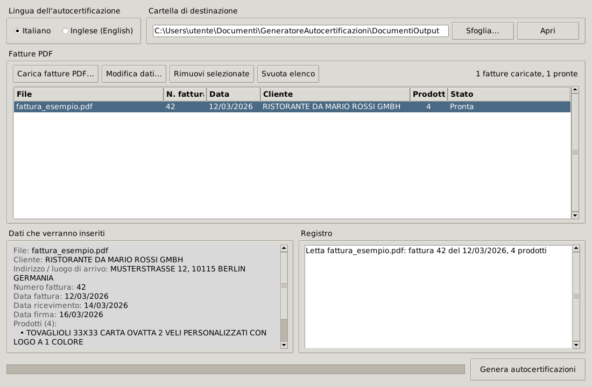

# Generatore Autocertificazioni

Applicazione desktop in Python che legge le **fatture PDF** di un'azienda e genera in automatico le
**dichiarazioni di ricevimento merce** (art. 45-bis Reg. UE 282/2011) da far firmare ai clienti esteri,
in italiano o in inglese, già pronte in PDF e ordinate in una cartella per cliente.



---

## Il problema

Quando un'azienda italiana vende merce a un cliente di un altro Paese UE e il trasporto è a cura del
cliente, per applicare la non imponibilità IVA deve poter dimostrare che la merce è arrivata a destinazione.
Una delle prove previste dall'**art. 45-bis del Regolamento di esecuzione (UE) 282/2011** è una
dichiarazione scritta dell'acquirente che indica cosa ha ricevuto, con quale fattura, dove e quando.

Compilare a mano una dichiarazione per ogni fattura (nome cliente, indirizzo, elenco prodotti, numero e
data fattura, date di ricevimento e firma) è lento e soggetto a errori di copiatura. Questo programma
nasce per automatizzare il lavoro in un'azienda reale (tipografia / stampa / ricamo con clienti in altri
Paesi UE): si caricano le fatture, si controllano i dati letti e con un clic si ottengono
tutti i PDF.

## Funzionalità

- **Lettura automatica delle fatture PDF**: numero e data fattura, nome e indirizzo del cliente,
  elenco dei prodotti (anche con descrizioni su più righe e fatture su più pagine).
- **Interfaccia grafica** (Tkinter) con elenco delle fatture, anteprima dei dati che verranno inseriti
  e registro delle operazioni.
- **Correzione manuale**: doppio clic su una fattura per modificare i dati; le fatture non leggibili
  restano in elenco e si possono completare a mano.
- **Due lingue**: modello italiano o inglese, scelto con un clic.
- **Compilazione di un template Word** mantenendo la formattazione originale; i valori inseriti
  sono evidenziati in grassetto sottolineato.
- **Conversione in PDF** tramite LibreOffice in modalità headless, su un thread separato per non
  bloccare la finestra, con barra di avanzamento.
- **Output organizzato**: `DocumentiOutput/<Nome cliente>/Dichiarazione_Fattura_<n>_data_<gg-mm-aaaa>.pdf`.
- **Uso anche da riga di comando** per elaborare più fatture in un colpo solo.
- **Programma Windows pronto all'uso** (`Autocertificazioni.exe`) creato con PyInstaller, per chi
  in azienda non ha Python installato.

## Come funziona

```
fattura.pdf ──► pdfplumber ──► DatiFattura ──► python-docx ──► .docx compilato ──► LibreOffice ──► .pdf
               (parole +       (dataclass con   (sostituisce i                     (--headless
                coordinate)     validazione)     segnaposto {{...}})                --convert-to pdf)
```

1. **Estrazione dei dati** – `pdfplumber` restituisce ogni parola con le sue coordinate. Il programma
   ricostruisce le righe raggruppando le parole per posizione verticale e poi:
   - trova numero e data con un'espressione regolare sul testo `nr. FPR 42/26 del 12/03/2026`;
   - individua il riquadro **CLIENTE** e prende le parole allineate sotto l'intestazione: le righe prima
     di `Id Fiscale` sono il nome, quelle dopo (fino a `Codice destinatario`) sono l'indirizzo;
   - nella tabella **PRODOTTI E SERVIZI** usa la posizione delle colonne `DESCRIZIONE` e `QUANTITA'`
     per leggere solo le descrizioni; una riga senza numero d'ordine viene unita al prodotto precedente.
     La tabella termina al titolo successivo (scritto con un carattere più grande) o al piè di pagina.
2. **Calcolo delle date** – data di ricevimento = data fattura + 2 giorni, data di firma = ricevimento + 2
   giorni (valori configurabili in cima allo script).
3. **Compilazione del template** – Word spesso spezza un segnaposto come `{{NOME_CLIENTE}}` su più
   *run* con formattazioni diverse. La funzione `sostituisci_nel_paragrafo` ricostruisce il testo del
   paragrafo, ricorda a quale run appartiene ogni carattere e ricrea i run copiandone lo stile, così il
   documento finale mantiene l'impaginazione del modello. Vengono gestiti anche tabelle (annidate),
   intestazioni e piè di pagina.
4. **Conversione in PDF** – LibreOffice viene avviato con un profilo utente dedicato, così la conversione
   funziona anche se LibreOffice è già aperto.
5. **Distribuzione** – quando gira come `.exe` il programma legge i template inclusi nell'eseguibile
   (`sys._MEIPASS`), ma se accanto all'`.exe` c'è un template con lo stesso nome usa quello: così il
   modello si può aggiornare senza ricreare il programma.

## Download per Windows (senza installare Python)

Se vuoi solo usare il programma, scarica `Autocertificazioni.exe` dalla pagina
[**Releases**](../../releases) del repository e segui le istruzioni in [`ISTRUZIONI.txt`](ISTRUZIONI.txt).
Serve solo [LibreOffice](https://www.libreoffice.org/download/), per creare i PDF.

Al primo avvio Windows potrebbe mostrare *"Windows ha protetto il PC"*, perché l'eseguibile non ha una
firma digitale: clicca *Ulteriori informazioni* → *Esegui comunque*.

## Requisiti (per eseguire dal codice sorgente)

- **Python 3.10** o superiore (su Windows Tkinter è già incluso)
- **LibreOffice** – serve per la conversione Word → PDF ([download](https://www.libreoffice.org/download/))
- Librerie Python: `pdfplumber`, `python-docx` (vedi `requirements.txt`)

Il programma cerca LibreOffice nei percorsi standard di Windows e macOS e nel `PATH`.

## Installazione

```bash
git clone https://github.com/S6520241/generatore-autocertificazioni.git
cd <nome-repository>

python -m venv .venv
# Windows
.venv\Scripts\activate
# macOS / Linux
source .venv/bin/activate

pip install -r requirements.txt
```

Su Linux (Debian/Ubuntu) servono anche Tkinter e LibreOffice:

```bash
sudo apt install python3-tk libreoffice-writer
```

## Utilizzo

### Interfaccia grafica

```bash
python genera_documenti.py
```

1. Scegli la lingua (Italiano / Inglese) e la cartella di destinazione.
2. Clicca **Carica fatture PDF…** e seleziona una o più fatture.
3. Controlla i dati nel riquadro *Dati che verranno inseriti*; se qualcosa non va, doppio clic sulla riga
   per correggerlo.
4. Clicca **Genera autocertificazioni**. Al termine il programma propone di aprire la cartella di output.

### Riga di comando

```bash
python genera_documenti.py fattura1.pdf fattura2.pdf --lingua it --output DocumentiOutput
```

| Opzione     | Descrizione                                   | Predefinito         |
|-------------|-----------------------------------------------|---------------------|
| `fatture`   | uno o più file PDF                            | (nessuno = apre la GUI) |
| `--lingua`  | `it` oppure `en`                              | `it`                |
| `--output`  | cartella in cui salvare le dichiarazioni      | `./DocumentiOutput` |

## Provalo subito con la fattura di esempio

Nella cartella `esempi/` c'è una fattura **completamente fittizia** (fornitore, cliente e partite IVA
inventati) con lo stesso layout delle fatture reali:

```bash
python genera_documenti.py esempi/fattura_esempio.pdf
python genera_documenti.py esempi/fattura_esempio.pdf --lingua en
```

Il risultato atteso è già incluso in `esempi/output/`:

| Input | Output |
|-------|--------|
| [`esempi/fattura_esempio.pdf`](esempi/fattura_esempio.pdf) | [`Dichiarazione_Fattura_42_data_12-03-2026.pdf`](esempi/output/Dichiarazione_Fattura_42_data_12-03-2026.pdf) (IT) |
| | [`Dichiarazione_Fattura_42_data_12-03-2026_EN.pdf`](esempi/output/Dichiarazione_Fattura_42_data_12-03-2026_EN.pdf) (EN) |

Puoi caricare la stessa fattura anche dall'interfaccia grafica con **Carica fatture PDF…**.

## Creare l'eseguibile Windows

Su Windows, con Python installato, fai doppio clic su **`crea_programma.bat`**. Lo script:

1. installa `pdfplumber`, `python-docx` e `pyinstaller`;
2. crea un unico file `Autocertificazioni.exe` senza console (`--onefile --windowed`), con i due
   template inclusi;
3. prepara la cartella `Da_consegnare\Autocertificazioni\` con l'`.exe` e `ISTRUZIONI.txt`, pronta
   da copiare sul computer di chi userà il programma.

In alternativa, a mano dal Prompt dei comandi:

```bat
pip install pyinstaller
pyinstaller --noconfirm --clean --onefile --windowed --name Autocertificazioni ^
    --add-data "template_autocertificazione_it.docx;." ^
    --add-data "template_autocertificazione_en.docx;." ^
    genera_documenti.py
```

L'eseguibile viene creato in `dist/`. Le cartelle `build/`, `dist/` e `Da_consegnare/` sono escluse dal
repository: l'`.exe` si pubblica come allegato di una *Release*.

## Formato delle fatture supportato

Il lettore è pensato per le fatture PDF prodotte dal gestionale dell'azienda (copia analogica di fattura
elettronica). Perché i dati vengano letti automaticamente, la fattura deve contenere:

- il testo `nr. FPR <numero>/<anno> del <gg/mm/aaaa>`;
- un riquadro intitolato `CLIENTE` con nome, riga `Id Fiscale:` (oppure `P.IVA`, `C.F.`…), indirizzo
  e riga `Codice destinatario` (oppure `PEC`, `Tel`…);
- una tabella sotto `PRODOTTI E SERVIZI` con le colonne `DESCRIZIONE` e `QUANTITA'`.

Le fatture con un layout diverso (o scansionate, senza testo) vengono comunque caricate: i dati si
inseriscono a mano dalla finestra *Modifica dati*.

## Template e segnaposto

I modelli sono normali file Word: si possono modificare liberamente (testo, impaginazione, logo) purché
contengano i segnaposto tra doppie graffe.

| Segnaposto                  | Valore inserito                                   |
|-----------------------------|---------------------------------------------------|
| `{{NOME_CLIENTE}}`          | ragione sociale del cliente                        |
| `{{INDIRIZZO_CLIENTE}}`     | indirizzo del cliente                              |
| `{{DESCRIZIONE_BENI}}`      | elenco dei prodotti, uno per riga                  |
| `{{NUMERO_FATTURA}}`        | numero della fattura                               |
| `{{DATA_FATTURA}}`          | data della fattura                                 |
| `{{LUOGO_ARRIVO}}`          | luogo di arrivo della merce (indirizzo del cliente) |
| `{{DATA_RICEVIMENTO}}`      | data fattura + 2 giorni                            |
| `{{DATA_FIRMA}}`            | data ricevimento + 2 giorni                        |
| `{{PERSONA_ACCETTAZIONE}}`  | lasciato vuoto, lo compila chi firma               |

## Struttura del progetto

```
.
├── genera_documenti.py                 # applicazione (lettura PDF, compilazione, GUI, CLI)
├── template_autocertificazione_it.docx # modello in italiano
├── template_autocertificazione_en.docx # modello in inglese
├── crea_programma.bat                  # crea Autocertificazioni.exe con PyInstaller
├── ISTRUZIONI.txt                      # guida per chi usa il programma .exe
├── requirements.txt
├── esempi/
│   ├── fattura_esempio.pdf             # fattura fittizia per provare il programma
│   └── output/                         # dichiarazioni generate dalla fattura di esempio
└── docs/
    └── screenshot.png
```

## Possibili sviluppi

- Test automatici (`pytest`) sull'estrazione dei dati con un set di fatture di esempio.
- Regole di lettura configurabili (file YAML/JSON) per supportare layout di fattura diversi.
- Conversione in PDF senza LibreOffice (ad es. `docx2pdf` su Windows con Word installato).
- Build automatica dell'`.exe` a ogni nuova versione con GitHub Actions.

## Privacy

Il repository non contiene dati reali. Tutti i nomi, gli indirizzi e le partite IVA presenti negli esempi sono
inventati.

---

*Progetto realizzato da Francesco Giuseppino per automatizzare un'attività amministrativa di un azienda*
